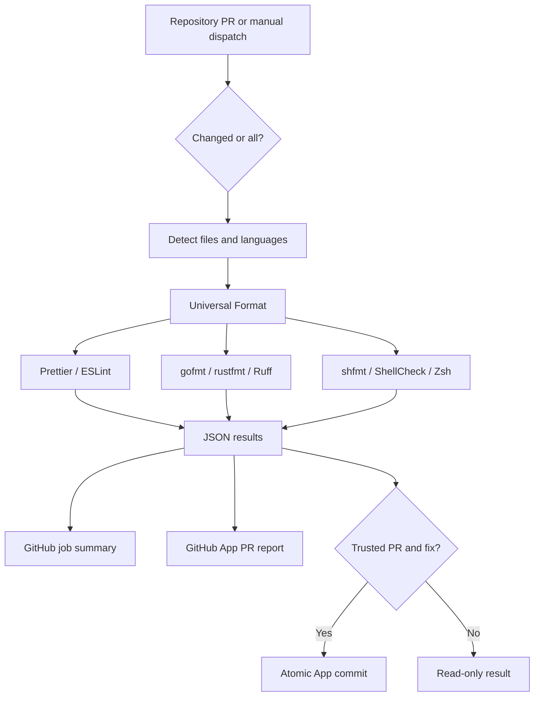

# 🦾 Rod Actions
> **One toolbox. Many repositories. Fewer YAML jungles.** A TypeScript/Node 24 collection of reusable GitHub Actions, CI workflows, release tooling and the Rod Console.

[](https://www.typescriptlang.org/)
[](https://github.com/rodkisten/github/actions)
[](https://github.com/rodkisten/github/releases)
[](docs/ARCHITECTURE.md)

[**🚀 Start here**](#-quick-start) · [**🎨 Format & lint**](docs/FORMAT.md) · [**🧩 Console**](docs/ACTIONS_CONSOLE.md) · [**🏷️ Releases**](docs/HYBRID_RELEASE.md) · [**🤖 GitHub App**](docs/USAGE.md)

---

## ✨ At a glance

| Feature | What you get | Guide |
| :-- | :-- | :-- |
| 🎨 **Universal format** | Check or fix changed files or the whole repository, language-aware | [Format & lint](docs/FORMAT.md) |
| 🐚 **Shell quality** | Bash/POSIX shfmt + ShellCheck + syntax; Zsh syntax validation | [Shell matrix](docs/FORMAT.md#-language-support) |
| 🧩 **Actions Console** | Central configuration, format invocation, job/step event collection | [Console](docs/ACTIONS_CONSOLE.md) |
| 🤖 **App-powered changes** | Atomic commits and PR creation with short-lived GitHub App tokens | [Usage](docs/USAGE.md) |
| 🧭 **Path-aware CI** | Run only affected groups with reusable filters and matrix | [CI architecture](docs/ARCHITECTURE.md) |
| 🏷️ **Hybrid releases** | Automatic Conventional Commits or manual SemVer bump | [Hybrid release](docs/HYBRID_RELEASE.md) |
| 🌈 **rodlog** | Readable build, test and release logs | [rodlog](docs/RODLOG.md) |

<details>
<summary><strong>📚 Complete documentation index</strong></summary>

- [Universal format: modes, languages, inputs, outputs, PR comments and troubleshooting](docs/FORMAT.md)
- [Actions Console: configuration, hooks and formatting](docs/ACTIONS_CONSOLE.md)
- [Hybrid releases and versioning](docs/HYBRID_RELEASE.md)
- [Reusable workflow examples](docs/USAGE.md)
- [Architecture and security](docs/ARCHITECTURE.md)
- [Releasing this repository](docs/RELEASING.md)
- [rodlog integration](docs/RODLOG.md)

</details>

## 🚀 Quick start

> [!IMPORTANT]
> For a consuming repository, use a **released tag or immutable commit SHA** after the action bundles have been published. The `@main` examples below track ongoing development and can change without notice.

### 1. Run format checks on changed files

```yaml
name: 🎨 Format
on:
  pull_request:
permissions:
  contents: read
jobs:
  format:
    runs-on: ubuntu-latest
    steps:
      - uses: actions/checkout@v4
        with:
          fetch-depth: 0
      - uses: actions/setup-node@v4
        with:
          node-version: '24'
      - run: npm ci
      - uses: rodkisten/github/actions/format@main
        id: format
        with:
          mode: check
          scope: changed
          base: origin/main
          lint: 'true'
```

> [!NOTE]
> This Action uses tools already installed on the runner. Install the formatter(s) your project needs before invoking it. Zsh formatting is **not** supported; Zsh syntax checking is.

### 2. Fix the entire repository

```yaml
- uses: rodkisten/github/actions/format@main
  id: format
  with:
    mode: fix
    scope: all
    lint: 'true'
```

The Action changes the working tree. It does **not** push automatically. See [GitHub App auto-commit and PR reporting](docs/FORMAT.md#-automatic-pr-workflow) for the separate, privileged workflow.

### 3. Use centralized Node CI

```yaml
name: 🧪 CI
on:
  pull_request:
jobs:
  verify:
    uses: rodkisten/github/.github/workflows/node-ci.yml@main
    with:
      node-version: '24'
      test-command: npm test
      build-command: npm run build
```

### 4. Invoke the Console

```yaml
- uses: actions/checkout@v4
- uses: actions/checkout@v4
  with:
    repository: rodkisten/github
    path: .rod-actions
- uses: rodkisten/github/actions/console@main
  with:
    defaults: .rod-actions/config/rod-actions.yml
    format-mode: check
    format-scope: changed
    format-base: origin/main
```

## 🧱 Action catalog

| Action | Purpose | Notes |
| :-- | :-- | :-- |
| `actions/format` | Format and lint | `check/fix`, `changed/all` |
| `actions/format-report` | Sticky PR summary | GitHub App token required |
| `actions/console` | Resolve config, format and collect events | Read-only reporter |
| `actions/console-run` | Instrument command execution | Explicit Bash runner |
| `actions/app-token` | Mint installation token | Least privilege |
| `actions/commit` | Atomic multi-file commit | Git Database API |
| `actions/create-pr` | Create/update PR | Reuses open PR |
| `actions/paths-filter` | Discover affected paths | YAML and glob |
| `actions/node-ci` | Execute Node checks | Configurable |
| `actions/ci-summary` | Markdown summary | GitHub job summary |
| `actions/setup-node` | Node bootstrap | Shared |
| `actions/setup-rodlog` | Install rodlog | Structured logs |
| `actions/skip-ci` | Skip decision | Opt-in |

## 🗺️ Architecture



## 🎛️ Modes

| Input | Choices | Default | Behavior |
| :-- | :-- | :-- | :-- |
| `mode` | `check`, `fix` | `check` | Verify only or rewrite |
| `scope` | `changed`, `all` | `changed` | Diff from base or tracked repository |
| `base` | Git ref | `origin/main` | Comparison reference |
| `lint` | `true`, `false` | `true` | Additional lint where supported |

See the [full input/output reference](docs/FORMAT.md#-inputs-and-outputs), including `results-file`, `commit-files` and `suggested-commit`.

## 🛡️ Safety and limitations

> [!WARNING]
> Never pass an installation token to code from an untrusted fork. Automatic fixes and comments use GitHub App permissions only on trusted same-repository PRs. Always review generated changes.

- Missing tools can currently be reported as **skipped**. This is not a strict coverage guarantee.
- Large changes serialized into Action outputs may hit GitHub Actions output limits. Use a file-based transport before enabling broad monorepo auto-commit.
- Zsh gets `zsh -n`, **not** automatic formatting.
- The Console collects notification candidates; Relay delivery is not implemented.
- GitHub's `workflow_run` API is the reliable source for *completed* job outcomes, not a still-running step.

## 🧪 Development

```bash
npm ci
npm run typecheck
npm test
npm run build
```

> [!TIP]
> Prefer reusable TypeScript utilities and the existing GitHub App commit Action over custom shell scripts or duplicated API implementations.

## 🚦 Project status

- [x] TypeScript Node 24 shared Actions
- [x] Path-aware CI and atomic App commits
- [x] Hybrid releases and central Console
- [x] Universal format Action and Shell/Bash/Zsh checks in PR #10
- [x] PR report and App auto-commit wiring in PR #10
- [ ] Validate the latest PR #10 run end to end
- [ ] Replace large JSON output transport with file-backed commits
- [ ] Strict missing-tool policy and Zsh-aware formatter
- [ ] Relay notification transport and persistent deduplication

**Current work:** [PR #10 · Universal Format + Console](https://github.com/rodkisten/github/pull/10). Features listed as in-progress are **not** available on a published release until merged and released.
