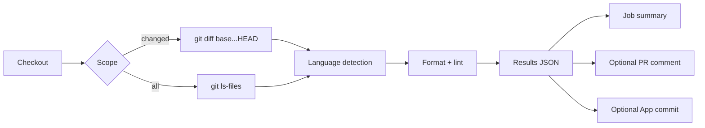

# 🎨 Universal Format & Lint

> **One Action, multiple languages, one readable PR report.** This guide covers the current PR #10 implementation. Features are not available to consumers until the Action bundles are merged and published.

[← README](../README.md) · [Console](ACTIONS_CONSOLE.md) · [CI](USAGE.md)

## 📑 Contents

- [Overview](#-overview)
- [Modes and scopes](#-modes-and-scopes)
- [Language support](#-language-support)
- [Quick recipes](#-quick-recipes)
- [Automatic PR workflow](#-automatic-pr-workflow)
- [Inputs and outputs](#-inputs-and-outputs)
- [Report example](#-report-example)
- [Security and permissions](#-security-and-permissions)
- [Troubleshooting](#-troubleshooting)
- [Current limitations](#-current-limitations)

## 🧭 Overview

`actions/format` is a standalone Node 24 JavaScript Action implemented in TypeScript. It detects files, chooses appropriate tools, emits structured results and writes to `GITHUB_STEP_SUMMARY`.



> [!IMPORTANT]
> The formatter **does not install tools**. Install dependencies in the caller's workflow. Some missing tools currently appear as `skipped`, so inspect the report instead of treating a green step as proof that every language was checked.

## 🎛️ Modes and scopes

| `mode` | `scope` | Result | Ideal for |
| :-- | :-- | :-- | :-- |
| `check` | `changed` | Verify affected tracked files | Pull requests |
| `fix` | `changed` | Rewrite affected files | Trusted PR auto-fix |
| `check` | `all` | Verify tracked repository | Nightly audits |
| `fix` | `all` | Rewrite tracked repository | Manual maintenance |

`changed` uses `git diff --name-only --diff-filter=ACMR base...HEAD`. Fetch enough Git history (`fetch-depth: 0`) and make the base ref available. `all` uses `git ls-files`; untracked files are not included. `check` never intentionally rewrites source files.

<details>
<summary><strong>🧠 Why triple-dot diff?</strong></summary>

`base...HEAD` selects changes since the merge base, matching the intent of a pull request. It avoids treating unrelated changes already on `main` as part of your PR.

</details>

## 🧬 Language support

| Files | Format tool | Lint / validation | Fix behavior |
| :-- | :-- | :-- | :-- |
| `js jsx mjs cjs ts tsx mts cts` | Prettier | ESLint, when installed | Prettier write + ESLint fix |
| `json jsonc yaml yml` | Prettier | Prettier parsing | Write |
| `css scss less` | Prettier | Prettier parsing | Write |
| `html vue svelte astro` | Prettier | Prettier parsing | Write |
| `md mdx graphql gql` | Prettier | Prettier parsing | Write |
| `go` | gofmt | gofmt check | Write |
| `rs` | rustfmt | rustfmt check | Write |
| `py` | Ruff | `ruff format --check` | Write |
| `sh`, POSIX shebang | shfmt POSIX | ShellCheck + `sh -n` | Write |
| `bash`, Bash startup files/shebang | shfmt Bash | ShellCheck + `bash -n` | Write |
| `zsh`, Zsh startup files/shebang | **Not supported** | `zsh -n` | **No rewrite** |

### 🐚 Shell-specific behavior

Bash: `shfmt -ln bash`, `shellcheck -s bash`, `bash -n`.

POSIX shell: `shfmt -ln posix`, `shellcheck -s sh`, `sh -n`.

Zsh: `zsh -n` only. The formatter recognizes `.zshrc`, `.zprofile`, `.zshenv`, `.zlogin`, `.zlogout` and `.zsh`.

> [!CAUTION]
> **Do not use shfmt or ShellCheck on arbitrary Zsh syntax.** Neither is a full Zsh parser. A dedicated Zsh-compatible formatter must be integrated before offering `fix` for Zsh.

### Tool installation

For JS/TS projects, install `prettier` and optionally `eslint` in the consuming repository. For other languages, ensure `gofmt`, `rustfmt`, `ruff`, `shfmt`, `shellcheck` and/or `zsh` are available on the runner as needed. The Action uses `node_modules/.bin/prettier` and `node_modules/.bin/eslint` for JS tooling.

## 🚀 Quick recipes

### 1. Read-only PR verification

```yaml
name: 🎨 Format check
on:
  pull_request:
permissions:
  contents: read
jobs:
  format:
    runs-on: ubuntu-latest
    steps:
      - uses: actions/checkout@v4
        with:
          fetch-depth: 0
      - uses: actions/setup-node@v4
        with:
          node-version: '24'
      - run: npm ci
      - uses: rodkisten/github/actions/format@main
        id: format
        with:
          mode: check
          scope: changed
          base: origin/main
          lint: 'true'
```

### 2. Fix only modified files

```yaml
- uses: rodkisten/github/actions/format@main
  id: format
  with:
    mode: fix
    scope: changed
    base: origin/main
    lint: 'true'
```

### 3. Audit the whole repository

```yaml
- uses: rodkisten/github/actions/format@main
  with:
    mode: check
    scope: all
```

### 4. Manual full rewrite

```yaml
- uses: rodkisten/github/actions/format@main
  id: format
  with:
    mode: fix
    scope: all
```

> [!WARNING]
> A `fix` operation changes the checkout, not the remote branch. Commit/push is a separate, privileged operation.

### 5. Save JSON results for a reporter

```yaml
- uses: rodkisten/github/actions/format@main
  id: format
  with:
    mode: check
    scope: changed
    results-file: ${{ runner.temp }}/format-results.json
- uses: actions/upload-artifact@v4
  with:
    name: rod-format-results
    path: ${{ runner.temp }}/format-results.json
```

## 🤖 Automatic PR workflow

The repository includes `.github/workflows/format-pr.yml`, which validates TypeScript, runs tests, builds the Action bundles, invokes `format`, authenticates the GitHub App for trusted same-repository PRs, invokes `actions/commit` for changed files and updates a sticky PR comment through `actions/format-report`.

<details>
<summary><strong>🔐 Why use a GitHub App instead of a personal token?</strong></summary>

An installation token is short-lived and permission-scoped. The existing `actions/commit` uses GitHub's Git Database API to commit multiple files atomically without forcing a branch update. Keep `BOT_APP_ID` and `BOT_PRIVATE_KEY` in GitHub Actions secrets. Never expose them to untrusted fork code.

</details>

The current implementation uses `ploocky[bot]` as the commit identity. The suggested message follows Conventional Commits:

```text
style(format): normalize 12 files [skip ci]
```

> [!NOTE]
> `[skip ci]` avoids repeating expensive jobs for intermediate auto-fix commits where workflows respect that marker. It does **not** override GitHub Actions event semantics universally.

### How to trigger manually

Open **Actions → 🎨 Format PR → Run workflow**, choose `scope` (`changed` or `all`) and `mode` (`check` or `fix`). The workflow's App-commit step is intended for trusted PR events, not an arbitrary manual dispatch.

### PR report

The `actions/format-report` Action searches for a comment containing `<!-- rod-format-report -->` authored by a bot and updates it rather than posting a new comment each run. The report contains a tool matrix, counts, changed-file details, errors and a suggested commit.

## 📥 Inputs and outputs

### `actions/format`

| Input | Required | Default | Description |
| :-- | :--: | :-- | :-- |
| `mode` | No | `check` | `check` or `fix` |
| `scope` | No | `changed` | `changed` or `all` |
| `base` | No | `origin/main` | Git comparison ref |
| `lint` | No | `true` | Enable supported lint tools |
| `results-file` | No | none | Path for structured JSON report |

| Output | Format | Use |
| :-- | :-- | :-- |
| `changed-files` | JSON array | Files changed in the working tree |
| `commit-files` | JSON array | `{path,content}` payload for `actions/commit` |
| `result-json` | JSON array | Per-tool status |
| `suggested-commit` | String | Conventional Commit template |

### `actions/format-report`

| Input | Required | Description |
| :-- | :--: | :-- |
| `github-token` | Yes | App installation token with Issues write |
| `pr-number` | Yes | Pull request number |
| `results-file` | Yes | JSON output path from `format` |
| `mode` | No | Display mode |
| `scope` | No | Display scope |

### Console integration

`actions/console` accepts `format-mode` (`off/check/fix`), `format-scope` (`changed/all`) and `format-base` (comparison ref). See [Console guide](ACTIONS_CONSOLE.md).

## 📊 Report example

> **Illustrative output**, not a claim about the latest PR run.

| Language | Tool | Files | Status |
| :-- | :-- | --: | :-- |
| TypeScript | Prettier | 14 | ✅ ok |
| JavaScript | ESLint | 9 | ✅ ok |
| Bash | shfmt | 2 | ✅ ok |
| Bash | ShellCheck | 2 | ❌ failed |
| Zsh | zsh -n | 1 | ⚠️ skipped |

<details>
<summary>❌ Example ShellCheck diagnostics</summary>

```text
scripts/install.sh:12:4: warning: Double quote to prevent globbing
```

</details>

```text
style(format): normalize 5 files [skip ci]
```

## 🛡️ Security and permissions

- Read-only checks need `contents: read`.
- The PR reporter requires an App token with `issues: write`.
- App commits require `contents: write` and a trusted same-repository branch.
- Do not run privileged fix/commit steps on fork code.
- Do not force-push or overwrite a branch after another actor has updated it.
- Use immutable release tags or SHAs in production callers.

## 🧯 Troubleshooting

<details>
<summary><strong>“Input required and not supplied: message”</strong></summary>

This occurred when the bundled formatter did not execute its entrypoint and therefore did not emit `suggested-commit`. Dedicated `src/format/entry.ts` and `report-entry.ts` now invoke the Action main functions. Validate the new CI run before considering the fix confirmed.

</details>

<details>
<summary><strong>Why are tools marked skipped?</strong></summary>

The Action does not install formatters. A missing executable may produce `skipped`. Install it in the caller or configure a strict coverage gate. The current implementation does not yet fail every missing-tool case.

</details>

<details>
<summary><strong>Why did the formatter check the wrong files?</strong></summary>

Ensure `fetch-depth: 0`, a valid `base` and checkout of the PR head rather than a temporary merge commit. `changed` uses `base...HEAD`.

</details>

<details>
<summary><strong>Why did an auto-commit not appear?</strong></summary>

Check the GitHub App token permissions, branch ownership, formatter `commit-files` output, and whether the workflow is a trusted PR event. Very large outputs can exceed GitHub Actions limits.

</details>

<details>
<summary><strong>Why doesn't Zsh get formatted?</strong></summary>

`zsh -n` checks syntax but does not rewrite. A Zsh-aware formatting engine remains a planned enhancement.

</details>

## 🚧 Current limitations

- [ ] Strict missing-tool policy and complete per-language lint coverage
- [ ] File-backed commit payloads for large repositories
- [ ] Zsh-specific automatic formatting
- [ ] End-to-end verification of the newest PR #10 workflow SHA
- [ ] Robust deduplication and retry behavior for PR report updates

[← Back to README](../README.md)
